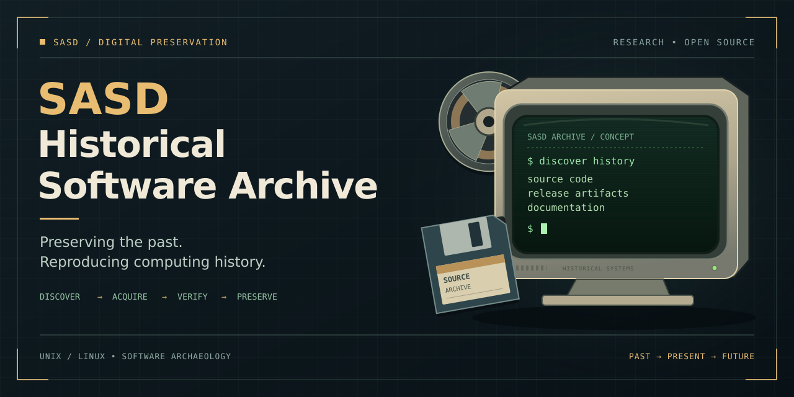
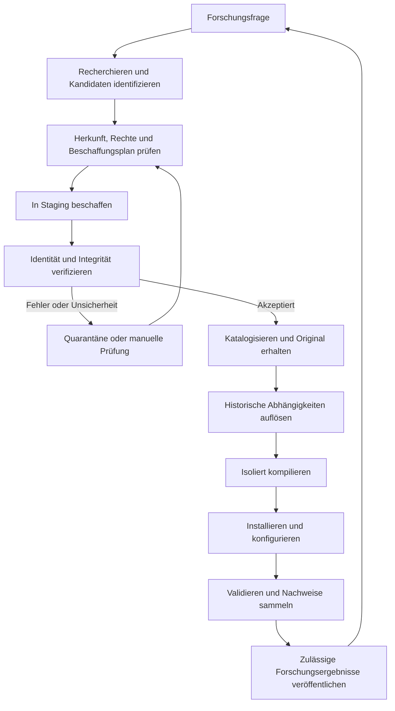
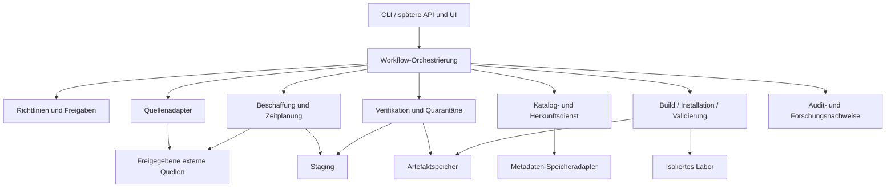

# SASD Historical Software Archive

[English](README.md) | Deutsch



**Die Vergangenheit bewahren. Computergeschichte reproduzieren.**

Eine Open-Source-Initiative zur Recherche, automatisierten Beschaffung, Verifikation, Katalogisierung, Erhaltung und experimentellen Rekonstruktion historischer Software.

**Projektstatus (November 2026):** Konzeption und Initialisierung des Repositorys. HSAT 0.1 ist die erste geplante Implementierung; die nachfolgend beschriebene vollständige Forschungsplattform ist eine langfristige Zielvision, kein bereits vorhandenes Produkt. Derzeit existieren weder ein unterstützter Installationsbefehl noch eine öffentliche Artefaktsammlung oder eine lauffähige HSAT-Veröffentlichung.

## 1. Motivation und Forschungsziele

Historische Software verschwindet, wenn Projekte eingestellt, FTP-Server abgeschaltet, alte Versionen von Spiegelservern entfernt, Dateiformate obsolet oder Dokumentationen verloren werden. Ein Quellcodearchiv allein reicht oft nicht aus: Compiler, Bibliotheken, Betriebssystem, Patches, Konfiguration, Handbücher und praktisches Betriebswissen können ebenso wichtig sein.

Das Projekt soll reproduzierbare Softwareforschung über mehrere Jahrzehnte der Computergeschichte ermöglichen. Forschende sollen ermitteln können, welche Software zu einem bestimmten Zeitpunkt verfügbar war, historisch plausible Systeme rekonstruieren, ihr Verhalten untersuchen und die erforderlichen Nachweise für wiederholbare Experimente bereitstellen. Bestehende Archive sollen weder ersetzt noch wahllos kopiert werden.

Der anfängliche Schwerpunkt liegt auf UNIX/Linux und der Entwicklung der Systemadministration: Konfigurationsmanagement, Monitoring, Netzwerke, Speicher, Datensicherung, Datenbanken, Entwicklungswerkzeuge und Sicherheit. Historische DOS-, Windows-, BSD- und andere Plattformen, Anwendungen und Entwicklungsumgebungen können später bei entsprechender Relevanz und rechtlicher Zulässigkeit hinzukommen.

Ein erster zentraler Anwender ist das Projekt [Automating UNIX SysAdmin](https://github.com/Robin-Goerlach/Automating_Unix_SysAdmin). HSAT wird bewusst eigenständig entwickelt, damit andere SASD-Projekte und externe Forschende es wiederverwenden können.

## 2. Archiv und Toolkit

Das **SASD Historical Software Archive** ist die übergeordnete Initiative: eine Sammlung von Forschungsnachweisen, Katalogdaten, Erhaltungsverfahren und – soweit zulässig – originalen Softwareartefakten.

Das **Historical Software Acquisition Toolkit (HSAT)** ist die geplante Softwarekomponente. Sie soll Recherche, Beschaffung, Verifikation, Katalogisierung, Erhaltung, Rekonstruktion von Umgebungen und Forschungsabläufe koordinieren. HSAT soll auch mit lokalen Archiven anderer Einrichtungen oder Projekte arbeiten können.

Das öffentliche Git-Repository beherbergt primär HSAT-Quellcode, Dokumentation, Schemata, Tests und rechtlich veröffentlichbare Metadaten. Es ist nicht der Standardspeicherort für große Binärdateien, Datenträgerabbilder oder nicht frei weiterverteilbare Fremdartefakte. Speicher- und Verteilungsregeln sind von GitHub unabhängig.

## 3. Zweistufige Entwicklungsstrategie

Wir beginnen bewusst mit einem kleinen Werkzeug, das ein unmittelbares praktisches Problem löst, und entwickeln es anschließend zur vollständigen Plattform weiter. Ein erster Downloader darf nicht von einer fertigen Datenbank, einem Webportal, einer Virtualisierungsfarm oder einem umfassenden historischen Katalog abhängen.

### HSAT 0.1 – praktisches Beschaffungswerkzeug

Der erste Meilenstein ist ein schlankes, kommandozeilenorientiertes Werkzeug zur Beschaffung ausdrücklich ausgewählter historischer Dateien aus recherchierten Quellen. Geplante Funktionen:

- Eine kuratierte, versionierte Quellenliste mit URLs, Softwarekennungen, erwarteten Dateinamen und optionalen Prüfsummen, Größen, Lizenzinformationen und Quellenhinweisen einlesen.
- Beschaffungsplan ohne Netzwerktransfer anzeigen; einen einzelnen Eintrag oder eine freigegebene Liste sequenziell herunterladen.
- Unvollständige Downloads im Staging ablegen, bei Unterstützung sicher fortsetzen und verifizierte Artefakte nicht unbemerkt überschreiben.
- SHA-256 berechnen, verfügbare vertrauenswürdige Originalprüfsummen oder Signaturen bei entsprechender Unterstützung vergleichen, Abweichungen protokollieren und unverifiziertes Material getrennt halten.
- Quell-URL, effektive URL, Abrufzeitpunkt in UTC, Bytezahl, Hashwert, Status und aussagekräftige Fehlerdaten in einem maschinenlesbaren Manifest und verständlichen Protokollen erfassen.
- Bereits beschaffte und verifizierte Dateien überspringen; die Historie fehlgeschlagener Versuche erhalten. Vor und während Transfers freien Speicher prüfen, auf Anforderung sauber stoppen und später fortsetzen.
- Konservative Bandbreiten-, Anfrage-, Wiederholungs- und Volumengrenzen durchsetzen. Quellenspezifische Bedingungen beachten und bei Ablehnung oder anhaltenden Fehlern stoppen.
- Beschaffte Dateien bestehenden Forschungsprojekten offline bereitstellen, ohne heruntergeladene Programme automatisch auszuführen.

Eine kleine TSV- oder JSON-Quellenliste und Dateisystemspeicherung sind für diese Phase ausreichende Kandidaten. Format, Programmiersprache und Implementierungsdetails werden bei der Anforderungs- und Architekturarbeit ausgewählt; ein Datenbankserver ist keine Voraussetzung.

#### Vorgeschlagene anfängliche Download-Regeln

Dies sind konzeptionelle Ausgangswerte, keine bereits implementierten Einstellungen. Strengere quellenspezifische Regeln haben Vorrang.

| Kontrolle | Anfänglicher Zielwert |
| --- | --- |
| Gesamte Download-Bandbreite | 256 KiB/s über alle Transfers |
| Gleichzeitige Downloads | 1 |
| Tägliches Netzwerk-Transfervolumen | 10 GiB |
| Mindestabstand zwischen Anfragen an denselben Server | 5 Sekunden |
| Wiederholungen | Höchstens 3 Wiederholungen nach dem ersten Versuch, mit Wartezeitsteigerung |
| Fortsetzen | Nur bei Unterstützung und überprüfbarer Identität des entfernten Objekts |
| Speicherplatz | Konfigurierbarer Mindestfreiplatz und Staging-Kontingent |
| Stopp / Pause | Sichere Unterbrechung und persistenter Fortschritt |

Alle Worker, Wiederholungen, Weiterleitungen und fortgesetzten Downloads müssen die Gesamtgrenzen beachten; tatsächlich übertragene Bytes und nicht nur erfolgreich beschaffte Dateien zählen zum Tageslimit. Das genaue Abrechnungsfenster und die Persistenz werden in der Spezifikation definiert. Retry-After, Serverlimits, Nutzungsbedingungen und Zugriffsbeschränkungen sind einzuhalten. Identitäten oder Spiegelserver dürfen nicht zur Umgehung rotiert werden. Unbeaufsichtigtes flächendeckendes Crawling ist für 0.1 nicht erforderlich.

#### Abnahmekriterien für 0.1

Mit kontrollierten lokalen HTTP-Testquellen und einem kleinen rechtmäßig zugänglichen Praxistest sind erfolgreicher Download und Prüfsummenvergleich, Bandbreiten- und Volumengrenzen, Fehlerbehandlung, Unterbrechung und sicheres Fortsetzen, Duplikatvermeidung, Speicherplatzverweigerung, Dry-Run und nachvollziehbare Manifeste nachzuweisen. Negativtests müssen geänderte Quelldateien, unvollständige Inhalte, Prüfsummenabweichungen, Weiterleitungen und vorübergehende/dauerhafte Fehler abdecken. Ein fehlgeschlagenes Artefakt darf niemals als verifiziert erscheinen. Vor Abschluss des Meilensteins sind deutsche und englische Benutzerdokumentationen bereitzustellen.

### Vollständiges HSAT – Beschaffungs- und Forschungsplattform

Die vollständige Plattform soll den Lebenszyklus von einer Forschungsfrage bis zum wiederholbaren Experiment abdecken. An rechtlichen, sicherheitsrelevanten und durch Richtlinien bestimmten Grenzen bleibt eine manuelle Freigabe vorgesehen.

| Funktionsbereich | Langfristiges Ziel |
| --- | --- |
| Recherche | Freigegebene Archive, Original-Release-Verzeichnisse, historische Distributionen, Paketindizes, Spiegel und Literaturreferenzen über Quellenadapter durchsuchen. |
| Quellenverwaltung | Herkunft, Spiegelbeziehungen, Verfügbarkeit, Quellenzuverlässigkeit, Weiterleitungen, letzte Prüfungen und quellenspezifische Regeln erfassen. |
| Beschaffung | Persistente Warteschlangen, Prioritäten, Zeitplanung, fortsetzbare Transfers, kontrollierte Parallelität, globale/quellenspezifische Budgets und manueller Import lokaler Medien. |
| Verifikation | Hashwerte, Signaturen und Schlüsselherkunft, Quellenvergleich, Format-/Größenprüfung, Quarantäne und ausdrückliche Vertrauensstufen. |
| Katalog | Durchsuchbare, versionierte Datensätze für Projekte, Versionen, Veröffentlichungsdaten, Plattformen, Architekturen, Abhängigkeiten, Lizenzen, Dokumente und Artefakte. |
| Erhaltung | Unveränderliche Originalbytes, inhaltsadressierte Speicherung (CAS), Deduplizierung, Integritätsprüfungen, Backups, Wiederherstellungstests und kontrollierte Zugriffe. |
| Abhängigkeiten | Historisch passende Compiler, Bibliotheken, Betriebssysteme, Pakete, Patches, Werkzeuge und Konfigurationen ermitteln; Lücken und Unsicherheit dokumentieren. |
| Offline-Bereitstellung | Lokale Paketquellen oder Exportpakete mit Manifesten und Lizenzen erzeugen, soweit zulässig. |
| Build | Toolchains rekonstruieren, exakte Eingaben und Build-Protokolle erfassen, separat dokumentierte Patches anwenden und Originale von Ableitungen unterscheiden. |
| Installation | Installationen in isolierten VMs oder Emulatoren reproduzieren; Konfigurationen, Skripte, Snapshots und Fehler erfassen. |
| Validierung | Freigegebene Funktions- und Integrationstests ausführen, beobachtetes Verhalten mit historischen Quellen vergleichen, Nachweise und Negativergebnisse erhalten. |
| Forschung | Versionen und Epochen vergleichen, Dokumentation und Experimente verknüpfen, Reproduktionsmanifeste und Berichte exportieren, Hypothesen und Erkenntnisse erfassen. |
| Schnittstellen | Zunächst CLI; später optionale API, Suchoberfläche und Integrationen für unabhängige Projekte und Institutionen. |

Autonome Agenten können Quellen, Beschaffungspläne, Abhängigkeiten und Experimente vorschlagen, aber ein Vorschlag ist keine Berechtigung. Richtlinien, Rechteprüfung, Ressourcenbudgets und Ausführungsisolation bleiben ausdrückliche Kontrollen.

## 4. Forschungsablauf



Beispielsweise kann ein Forscher zur Untersuchung frühen Konfigurationsmanagements eine konkrete CFEngine-1- oder -2-Version, zeitgenössische Dokumentation und eine kompatible UNIX/Linux-Toolchain anfordern. HSAT soll langfristig jeden Kandidaten erfassen, Originaldistributionen von Spiegeln oder späteren Änderungen unterscheiden, zulässige Dateien erhalten und eine Testumgebung rekonstruieren, ohne unbemerkt moderne Software einzusetzen. Eine fehlende Abhängigkeit oder ein erfolgloser Build ist ein Forschungsergebnis, kein Anlass zur Erfindung von Nachweisen.

## 5. Vorgeschlagene modulare Architektur



Fachmodelle und Beschaffungslogik sollen von Netzwerktransport, Speichertechnologie und Benutzeroberflächen getrennt werden. Quellenadapter kapseln quellenspezifische Recherche und Protokolle; eine Richtlinienkomponente entscheidet über zulässige Aktionen; eine Orchestrierung steuert den Zustandsautomaten. Transfer-Worker dürfen die zentrale Zeitplanung nicht umgehen. Build- und Testausführung müssen von Beschaffungszugangsdaten und Schreibrechten auf das Archiv isoliert sein.

Die Entscheidung zur Katalogspeicherung bleibt bewusst offen: Versionierte JSON-/TSV-Dateien in Git, SQLite, MySQL, MariaDB oder PostgreSQL können untersucht werden. Metadatenschema, stabile Kennungen, Migrationen sowie Export-/Importverhalten sollen unabhängig vom Backend definiert werden. Große Artefaktdateien sind von Metadaten getrennt; der langfristige Speicher kann SHA-256-basierte Inhaltsadressierung und konfigurierbare lokale oder entfernte Backends verwenden.

## 6. Katalog, Provenienz und Reproduzierbarkeit

Das konzeptionelle Modell unterscheidet folgende Entitäten:

| Entität | Beispielhafte Informationen |
| --- | --- |
| Softwareprojekt | Namen, Maintainer, Ursprung, historischer Kontext |
| Release | Version, Veröffentlichungsdatum oder Zeitraum, Plattform, Architektur, Nachweise |
| Quelle | URL, Spiegel/Betreiber, Zugangsbedingungen, historische und aktuelle Beobachtungen |
| Artefakt | Originaldateiname, Medientyp, Größe, Hashwert, Rolle, Release-Zuordnung |
| Beschaffungsereignis | Angeforderte/effektive URL, UTC-Zeit, Ergebnis, Transport, Werkzeugversion |
| Verifikationsereignis | Algorithmus, erwarteter/gemessener Wert, Schlüssel- oder Nachweisquelle, Ergebnis |
| Rechte-Datensatz | Lizenz, Urheberhinweise, erlaubter Zugriff/Nutzung/Weitergabe, Prüfstatus |
| Abhängigkeit | Beziehung, Versionsbedingungen, Zielumgebung und Nachweis |
| Umgebung | Betriebssystem, Architektur, Toolchain, Pakete, VM-/Emulatoreinstellungen, Konfiguration |
| Experiment | Eingabe-Hashes, Rezept, Befehle, Protokolle, Ergebnisse, Fehler und Schlussfolgerungen |

Ein Release kann mehrere Artefakte und Quellen haben; ein byteidentisches Artefakt kann an mehreren Quellen beobachtet werden, ohne dass deren getrennte Beschaffungshistorien verloren gehen. Widersprüchliche Nachweise sind zu erhalten; Datumsangaben, Zuschreibungen und Abhängigkeiten sind als bestätigt, abgeleitet oder unbekannt zu kennzeichnen. Eine lokal berechnete Prüfsumme beweist spätere Bytekonsistenz, nicht Authentizität; ein erfolgreicher Download beweist weder eine Lizenz noch einen erfolgreichen Build.

UTC-Zeitstempel für Ereignisse verwenden, historische Veröffentlichungsdaten von Abrufdaten unterscheiden und den ursprünglichen Bytestrom erhalten. Ableitungen (entpackt, repariert, gepatcht, konvertiert oder kompiliert) müssen eigene Kennungen und Verknüpfungen zu ihren Eingaben besitzen. Ein Reproduktionsmanifest soll langfristig Artefakt-Hashes, Umgebung, Rezepte, Patches, Werkzeugversionen und erwartete Testergebnisse festschreiben. Bitgenaue Reproduzierbarkeit ist anzustreben, wo machbar; sie ist von funktionaler oder historischer Reproduzierbarkeit zu unterscheiden.

## 7. Archivierungs- und Speicherstrategie

Vorgeschlagene Speicherstruktur außerhalb des Git-Checkouts:

```text
archive-root/
  staging/       # unvollständige oder ausstehende Transfers
  quarantine/    # unverifizierte oder verdächtige Objekte
  objects/       # unveränderliche Originalbytes, später inhaltsadressiert
  derivatives/   # entpackte, gepatchte oder kompilierte Ergebnisse
  manifests/     # portable Bestandslisten und Nachweise
  exports/       # freigegebene Offline-Pakete / lokale Paketquellen
  logs/          # Betriebs- und Auditprotokolle
```

Identische Inhalte deduplizieren, ohne den Quellenkontext zu verlieren. Regelmäßige Integritätsprüfungen durchführen, unabhängige Backups vorhalten und Wiederherstellung einschließlich Konsistenz zwischen Katalog und Objekten testen. Explizite Aufbewahrungs- und Löschregeln anwenden, insbesondere bei zugriffsbeschränkten oder unrechtmäßig beschafften Materialien. Git-Historie oder RAID allein sind kein Backup. Archivierbarkeit bedeutet nicht automatisch Weitergaberecht.

## 8. Quellen, Rechte und verantwortungsvoller Zugriff

Potenzielle Forschungsquellen sind Originalprojektseiten, offizielle Distributionsarchive, historische FTP-Spiegel, Universitätsarchive, das [Internet Archive](https://archive.org/), [Software Heritage](https://www.softwareheritage.org/), [Bitsavers](https://bitsavers.org/) und rechtmäßig besessene private Datenträger. Dies sind beispielhafte Rechercheansätze, keine freigegebene Scraping-Liste oder Aussage, dass jedes Objekt kopiert werden darf.

- Dateien nur über zulässige Zugänge beschaffen; geltendes Recht, Quellenbedingungen, gegebenenfalls Robots-Regeln, Rate-Limits, Zugriffskontrollen und ausdrückliche Verbote beachten.
- Rechte-Metadaten von technischer Integrität trennen. Öffentlich erreichbar, veraltet oder als Abandonware bezeichnet bedeutet weder gemeinfrei noch frei weiterverteilbar.
- Berechtigung zur Beschaffung, Aufbewahrung, Nutzung und Verteilung separat prüfen. Unbekannte oder widersprüchliche Rechte erfordern Prüfung; keine beschränkten Dateien veröffentlichen. Nicht herunterladen, wenn die rechtmäßige Beschaffung nicht feststeht.
- Keine Bezahlschranken, Lizenzkontrollen, Authentifizierung, CAPTCHAs oder Quellenbeschränkungen umgehen. Keine Zugangsdaten, privaten Daten oder proprietären Installationsschlüssel veröffentlichen.
- Urheberhinweise und Lizenzen bewahren; Korrekturen und Entfernungsanfragen unterstützen. Katalogreferenzen bereitstellen, wenn Originalbytes nicht veröffentlicht werden dürfen.

Die MIT-Lizenz dieses Repositorys gilt für SASD-Projektsoftware und zugehörige Dokumentation gemäß [LICENSE](LICENSE). Sie lizenziert keine Fremdsoftware, fremden Handbücher oder archivierten Artefakte um.

## 9. Sicherheit und Qualität

Alte Software kann bekannte Schwachstellen, manipulierte Inhalte oder unsichere Installationsprogramme enthalten. Sämtliche Downloads als nicht vertrauenswürdig behandeln. Bei Recherche und Beschaffung niemals Archivmaterial ausführen. Dateipfade und Archivextraktion prüfen, Pfadtraversierung und unsichere Links zurückweisen, Dekompression und Speicher begrenzen und Quarantäne getrennt halten. Mit minimalen Rechten arbeiten, Geheimnisse nicht in URLs/Logs einbetten, modernes TLS standardmäßig prüfen und Legacy-Protokolle ausdrücklich bewerten, statt Sicherheitskontrollen global abzuschalten.

Spätere Builds und Installationen sollen in entbehrlichen, isolierten VMs oder Emulatoren mit eingeschränktem Netzwerk, ohne Host-Zugangsdaten, mit CPU-/RAM-/Speicher-/Zeitgrenzen, kontrolliertem Artefaktimport/-export und nachvollziehbaren Freigaben erfolgen. Container allein sind keine ausreichende Grenze für beliebige historische Betriebssysteme oder unbekannte Binärdateien.

Die Entwicklung soll wiederholbare Tests, deterministische Testdaten, gezielte Fehlerinjektion, Integrationstests, versionierte Schemata und überprüfbare Architekturentscheidungen verwenden. CI soll nicht vom wiederholten Zugriff auf historische öffentliche Spiegel abhängen. Fehlgeschlagene Rekonstruktionen und Abweichungen von historisch belegtem Verhalten dokumentieren.

## 10. Roadmap (Vorschlag)

| Stufe | Schwerpunkt | Ergebnis |
| --- | --- | --- |
| 0 – Grundlage | Anforderungen, Richtlinien, Architektur und Beispielkatalog | Geprüfter Umfang und Abnahmetests |
| 0.1 – Beschaffung | Kuratierte Quellen, Downloader, Kontingente, Manifest | Kleines nutzbares Werkzeug für das Retro-UNIX-Projekt |
| Danach – Katalog und Archiv | Speicherabstraktion, Provenienz, CAS, Deduplizierung, Backup | Durchsuchbare und überprüfbare Erhaltung |
| Danach – Recherche und Orchestrierung | Quellenadapter, Zeitplanung, Abhängigkeitsgraph | Kontrollierte teilautonome Beschaffung |
| Danach – Rekonstruktion | Offline-Quellen, Build-Rezepte, isolierte VM-/Emulatorabläufe | Reproduzierbare historische Installationen |
| Vollständige Plattform | Validierung, Forschungsberichte, Schnittstellen, agentengestützte Abläufe | Durchgängige nachweisgestützte Forschung |

Den Stufen nach 0.1 werden bewusst keine festen Versionsnummern oder Termine zugeordnet. Anforderungen, Architekturentscheidungen und formale Abnahmekriterien sollen jedem Implementierungsblock vorausgehen.

## 11. Repository-Organisation

Aktuelle Dokumentationsgrundlage:

```text
SASD-Historical-Software-Archive/
  README.md
  README.de.md
  LICENSE
  docs/
    assets/
      project-banner.svg
```

Vorgeschlagene Ergänzungen im Zuge der Implementierung:

```text
  docs/          # Anforderungen, Architektur, ADRs, Handbücher, Forschungsregeln
  catalog/       # veröffentlichbare Quellenlisten und Metadaten
  schemas/       # versionierte Austauschformate
  src/           # HSAT-Kern und Adapter
  config/        # Beispielkonfiguration ohne Zugangsdaten
  scripts/       # Wartungs- und Entwicklungshelfer
  tests/         # Offline-Testdaten, Unit- und Integrationstests
  examples/      # beispielhafte Forschungsabläufe
```

Archivspeicher, VM-Abbilder, beschränkte Materialien und Laufzeitprotokolle bleiben standardmäßig außerhalb des öffentlichen Repositorys. Englisch ist die primäre Dokumentationssprache; deutsche Dokumentation wird parallel gepflegt.

## 12. Mitwirken

In der Anfangsphase sind historische Quellenhinweise mit Herkunfts- und Rechteinformationen, bekannte Release-/Versionsbeziehungen, Anforderungen, Reproduktionsrezepte, Testdaten und Entwurfsreviews besonders hilfreich. Meldungen über [GitHub Issues](https://github.com/Robin-Goerlach/SASD-Historical-Software-Archive/issues) einreichen. Keine beschränkte Software, Zugangsdaten oder sensiblen Daten an öffentliche Issues anhängen.

Für den tatsächlichen Implementierungsstand sind Repository-Historie und spätere Release Notes maßgeblich. Obige Planungsfunktionen dürfen nicht mit bereits ausgelieferten Funktionen verwechselt werden.

## 13. Lizenz und Projekt

Projekt: **SASD – Scientific and Software Development**. Projektsoftware und zugehörige Dokumentation: [MIT-Lizenz](LICENSE), unter Beachtung der obigen Abgrenzung von Fremdmaterial.

Verwandtes Projekt: [Automating UNIX SysAdmin](https://github.com/Robin-Goerlach/Automating_Unix_SysAdmin).

---

*Discover → Acquire → Verify → Preserve → Reproduce → Research*
