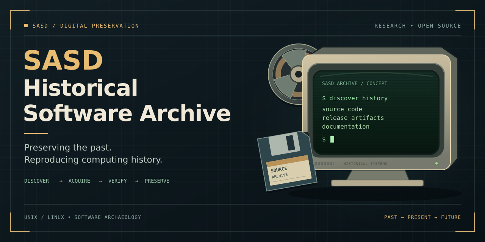
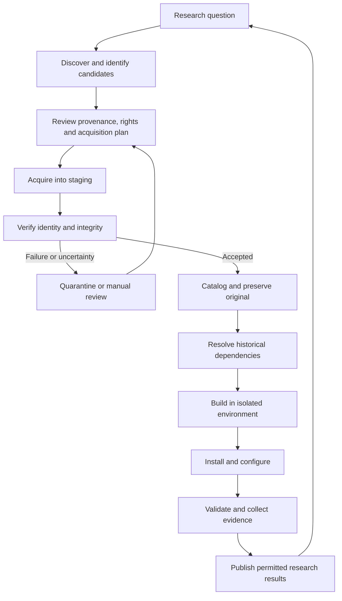
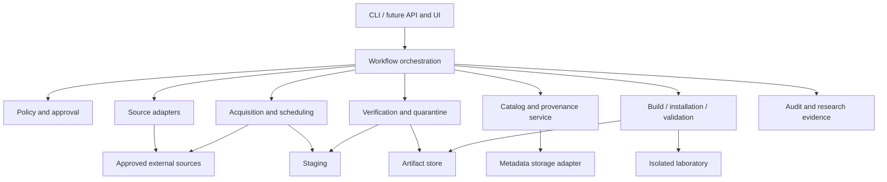

# SASD Historical Software Archive

[Deutsch](README.de.md) | English



**Preserving the past. Reproducing computing history.**

An open-source initiative for the discovery, automated acquisition, verification, cataloging, preservation and experimental reconstruction of historical software.

**Project status (November 2026):** concept and repository initialization. HSAT 0.1 is the first planned implementation; the complete research platform described below is a long-term vision, not an existing product. There is currently no supported installation command, public artifact collection or runnable HSAT release.

## 1. Motivation and research goals

Historical software disappears when upstream projects close, FTP servers are retired, mirrors remove old releases, file formats become obsolete or documentation is lost. A source archive alone is often insufficient: the corresponding compiler, libraries, operating system, patches, configuration, manuals and operational knowledge may be equally important.

The project aims to make historical software research reproducible across several decades of computing history. It should enable researchers to establish what was available at a particular time, reconstruct a historically plausible system, investigate how it behaved and share the evidence needed to repeat an experiment. It is not intended to replace existing archives or indiscriminately copy their holdings.

Initial emphasis is on UNIX/Linux and the evolution of system administration: configuration management, monitoring, networking, storage, backup, databases, build tools and security. Historical DOS, Windows, BSD and other platforms, applications and development environments may be included later where relevant and lawful.

A central first consumer is the [Automating UNIX SysAdmin](https://github.com/Robin-Goerlach/Automating_Unix_SysAdmin) project. HSAT is deliberately independent so that other SASD projects and external researchers can reuse it.

## 2. Archive and toolkit

The **SASD Historical Software Archive** is the umbrella initiative: a collection of evidence, catalog records, preservation practices and (where permitted) original software artifacts.

The **Historical Software Acquisition Toolkit (HSAT)** is its planned software component. It will coordinate discovery, acquisition, validation, cataloging, preservation, environment reconstruction and research workflows. HSAT should also work against local archives maintained by other institutions or projects.

The public Git repository is primarily the home of HSAT source code, documentation, schemas, tests and legally publishable metadata. It is not the default storage location for large binaries, disk images or restricted third-party artifacts. Storage and distribution policies are independent of GitHub.

## 3. Two-stage development strategy

We deliberately start with a small tool that solves an immediate practical problem, then grow it into the full platform. An initial downloader must not depend on the completion of a database, a web portal, a virtualization farm or a comprehensive historical catalog.

### HSAT 0.1 — practical acquisition tool

The first milestone is a lightweight, command-line-oriented tool for acquiring explicitly selected historical files from researched sources. Planned capabilities:

- Read a curated, versioned source list containing URLs, software identifiers, expected filenames and optional checksums, sizes, license information and source notes.
- Preview the acquisition plan without network transfers; download an individual item or process an approved list sequentially.
- Place partial downloads in staging, resume safely when supported, and avoid replacing a verified artifact silently.
- Compute SHA-256, compare available trusted upstream checksums or signatures when supported, record mismatches and keep unverified material separate.
- Record source URL, effective URL, retrieval time in UTC, byte count, digest, status and useful failure information in a machine-readable manifest and human-readable logs.
- Skip already acquired and verified files; preserve the history of failed attempts. Check available disk space before and during transfers, stop cleanly on request and resume later.
- Enforce conservative bandwidth, request, retry and volume limits. Respect source-specific conditions and stop on denial or persistent failure.
- Support offline use of the acquired files by existing research projects, without automatically running downloaded programs.

A small TSV or JSON source list and filesystem storage are sufficient candidates for this phase. The format, language and implementation details will be selected during requirements and design work; a database server is not a prerequisite.

#### Proposed initial download policy

These are baseline design targets, not implemented settings. Source-specific restrictions take precedence whenever stricter.

| Control | Initial target |
| --- | --- |
| Aggregate transfer rate | 256 KiB/s across all transfers |
| Concurrent downloads | 1 |
| Daily network transfer budget | 10 GiB |
| Minimum interval between requests to the same server | 5 seconds |
| Retries | At most 3 retries after the initial attempt, with backoff |
| Resume | Only when supported and the remote object identity can be validated |
| Disk space | Configurable minimum free space and staging quota |
| Stop / pause | Safe interruption and persistent progress |

All workers, retries, redirects and resumed transfers must respect the aggregate budget; actual transferred bytes, not just successful files, count toward the daily limit. The exact accounting window and persistence mechanism will be defined in the specification. Honor Retry-After, server rate limits, terms and access restrictions. Do not rotate identities or mirrors to evade them. No unattended broad crawling is required for 0.1.

#### Acceptance criteria for 0.1

Using controlled local HTTP fixtures and a small lawfully accessible real-world pilot, demonstrate successful download and checksum verification, bounded rate and volume, failure handling, interruption and safe resume, duplicate avoidance, disk-space refusal, dry-run behavior and an auditable manifest. Negative tests must cover a changed upstream file, truncated content, checksum mismatch, redirects and temporary/permanent failures. A failed item must never appear as a verified artifact. Provide English and German usage documentation before calling the milestone complete.

### Full HSAT — acquisition and research platform

The complete platform is intended to cover the lifecycle from a research question to a repeatable experiment, while keeping manual approval at legal, security and policy boundaries.

| Capability | Long-term objective |
| --- | --- |
| Discovery | Search approved archives, upstream release directories, historical distributions, package indexes, mirrors and bibliographic references through source adapters. |
| Source intelligence | Track origins, mirror relationships, availability, source reliability, redirects, last checks and source-specific policies. |
| Acquisition | Persistent queues, priorities, scheduling, resumable transfers, controlled concurrency, global/per-source budgets and manual import from local media. |
| Verification | Hashing, signature and key provenance, cross-source comparison, format/size validation, quarantine and explicit confidence levels. |
| Catalog | Searchable, versioned records for projects, versions, release dates, platforms, architecture, dependencies, licenses, documentation and artifacts. |
| Preservation | Immutable original bytes, content-addressed storage (CAS), deduplication, integrity audits, backup, restore tests and controlled access. |
| Dependencies | Identify historically appropriate compilers, libraries, operating systems, packages, patches, tools and configuration; record gaps and uncertainty. |
| Offline distribution | Generate local package sources or export bundles with manifests and licenses where permitted. |
| Build | Reconstruct toolchains, record exact inputs and build logs, apply separately recorded patches, distinguish original from derived files. |
| Installation | Reproduce installation in isolated VMs or emulators; capture configuration, scripts, snapshots and errors. |
| Validation | Execute approved functional and integration tests, compare observed behavior against historical sources, retain evidence and negative results. |
| Research | Compare versions and eras, correlate documentation with experiments, export reproducibility manifests and reports, track hypotheses and findings. |
| Interfaces | CLI first; later optional API, search UI and integrations for independent projects and institutions. |

Autonomous agents may propose sources, acquisition plans, dependency candidates and experiments, but proposals are not authorization. Policy, rights review, resource budgets and execution isolation remain explicit controls.

## 4. Research workflow



For example, a researcher studying early configuration management may request a particular CFEngine 1 or 2 release, contemporaneous documentation and a compatible UNIX/Linux toolchain. HSAT should eventually record each candidate, distinguish original distribution files from mirrors or later modifications, preserve permitted files, and reconstruct a test environment without silently substituting modern software. A missing dependency or an unsuccessful build is a research finding, not a reason to fabricate evidence.

## 5. Proposed modular architecture



The design should separate domain models and acquisition logic from network transport, storage technology and user interfaces. Source adapters encapsulate source-specific discovery and protocols; a policy engine decides whether actions are allowed; an orchestrator coordinates the state machine. Transfer workers should never bypass the scheduler. Build and test execution must be isolated from acquisition credentials and archive write access.

The catalog storage decision is deliberately open: versioned JSON/TSV files in Git, SQLite, MySQL, MariaDB or PostgreSQL may be evaluated. Metadata schema, stable identifiers, migrations and export/import behavior should be defined independently of the backend. Large artifact bytes are separate from metadata; the long-term store may use SHA-256-based content addressing and a configurable local or remote backend.

## 6. Catalog, provenance and reproducibility

The conceptual model distinguishes the following entities:

| Entity | Representative information |
| --- | --- |
| Software project | Names, maintainers, origin, historical context |
| Release | Version, release date or range, platform and architecture, evidence |
| Source | URL, mirror/operator, access conditions, historical and current observations |
| Artifact | Original filename, media type, size, digest, role, release association |
| Acquisition event | Requested/effective URL, UTC time, result, transport, tool version |
| Verification event | Algorithm, expected/observed value, key or evidence source, outcome |
| Rights record | License, copyright notices, allowed access/use/redistribution, review state |
| Dependency | Relationship, version constraints, target environment and evidence |
| Environment | OS, architecture, toolchain, packages, VM/emulator settings, configuration |
| Experiment | Input hashes, recipe, commands, logs, results, failures and conclusions |

A release can have several artifacts and sources; a byte-identical artifact can be observed at multiple sources without losing the separate acquisition histories. Preserve conflicting evidence and record whether dates, attribution or dependencies are confirmed, inferred or unknown. A locally computed checksum proves later byte consistency, not authenticity; a successful download does not prove a license or a successful build.

Use UTC timestamps for events, distinguish historical release dates from retrieval dates, and retain the original byte stream. Derivatives (unpacked, repaired, patched, converted or compiled material) must have their own identifiers and links to their inputs. A reproduction manifest should ultimately pin artifact hashes, environment, recipes, patches, tool versions and expected test outcomes. Bit-for-bit reproducibility is desirable where feasible; distinguish it from functional or historical reproducibility.

## 7. Preservation and storage policy

A proposed storage layout outside the Git checkout:

```text
archive-root/
  staging/       # incomplete or pending transfers
  quarantine/    # unverified or suspicious items
  objects/       # immutable original bytes, later content-addressed
  derivatives/   # unpacked, patched or built outputs
  manifests/     # portable inventories and evidence
  exports/       # approved offline bundles / local package sources
  logs/          # operational audit trail
```

Deduplicate identical content without discarding source context. Perform periodic integrity checks, keep independent backups and test restoration, including catalog-to-object consistency. Use explicit retention and deletion policies, particularly for restricted or unlawfully obtained material. A Git history or RAID alone is not a backup. Archive accessibility does not imply permission to redistribute.

## 8. Sources, rights and responsible access

Potential research sources include original project sites, official distribution archives, historical FTP mirrors, university archives, the [Internet Archive](https://archive.org/), [Software Heritage](https://www.softwareheritage.org/), [Bitsavers](https://bitsavers.org/) and privately held lawful media. These are illustrative research leads, not an approved scraping list or a statement that every item may be copied.

- Obtain files only through permitted access; respect applicable law, source terms, robots directives where relevant, rate limits, access controls and explicit prohibitions.
- Keep rights metadata separate from technical integrity. Publicly reachable, obsolete or labeled abandonware does not mean public domain or redistributable.
- Review permission to acquire, retain, use and distribute separately. Unknown or conflicting rights require review; do not publish restricted bytes. Avoid downloading content when lawful acquisition cannot be established.
- Do not bypass paywalls, licensing controls, authentication, CAPTCHAs or source restrictions. Do not publish credentials, private data or proprietary installation keys.
- Preserve copyright notices and licenses; support correction and takedown handling. Provide catalog references where publication of the original bytes is not permitted.

The MIT license in this repository covers the SASD project software and associated documentation as specified in [LICENSE](LICENSE). It does not relicense third-party software, manuals or archived artifacts.

## 9. Security and quality

Old software may contain known vulnerabilities, malicious modifications or unsafe installers. Treat all downloaded material as untrusted. Never execute an archive during discovery or acquisition. Validate file paths and archive extraction, reject traversal and unsafe links, limit decompression and storage, and keep quarantine separate. Use least privilege, avoid embedding secrets in URLs/logs, verify modern TLS by default, and explicitly review legacy protocols rather than disabling security controls globally.

Later builds and installations should run in disposable, isolated VMs or emulators with restricted networking, no host credentials, bounded CPU/RAM/storage/time, controlled artifact import/export and auditable approvals. Containers alone are not a sufficient boundary for arbitrary historical operating systems or unknown binaries.

Development should use repeatable tests, deterministic fixtures, failure injection, integration tests, versioned schemas and reviewable design decisions. CI should not depend on repeatedly contacting historical public mirrors. Document unsuccessful reconstructions and differences from historically attested behavior.

## 10. Roadmap (proposed)

| Stage | Focus | Outcome |
| --- | --- | --- |
| 0 — Foundation | Requirements, policies, architecture and sample catalog | Reviewed scope and acceptance tests |
| 0.1 — Acquisition | Curated sources, downloader, quotas, manifest | Useful small tool for the retro UNIX project |
| Next — Catalog and archive | Storage abstraction, provenance, CAS, deduplication, backup | Searchable and auditable preservation |
| Next — Discovery and orchestration | Source adapters, scheduling, dependency graph | Controlled semi-autonomous acquisition |
| Next — Reconstruction | Offline sources, build recipes, isolated VM/emulator workflows | Reproducible historical installations |
| Full platform | Validation, research reporting, interfaces, agent-assisted workflows | End-to-end evidence-based research |

Stages after 0.1 are intentionally not assigned fixed version numbers or dates. Requirements, architecture decisions and formal acceptance criteria should precede each implementation block.

## 11. Repository organization

Current documentation foundation:

```text
SASD-Historical-Software-Archive/
  README.md
  README.de.md
  LICENSE
  docs/
    assets/
      project-banner.svg
```

Proposed additions as implementation proceeds:

```text
  docs/          # requirements, architecture, ADRs, manuals, research policy
  catalog/       # publishable source lists and metadata
  schemas/       # versioned interchange formats
  src/           # HSAT core and adapters
  config/        # sample configuration, no credentials
  scripts/       # maintenance and development helpers
  tests/         # offline fixtures, unit and integration tests
  examples/      # illustrative research workflows
```

The archive store, VM images, restricted material and runtime logs remain outside the public repository by default. English is the primary documentation language; German documentation is maintained in parallel.

## 12. Getting involved

At this initial stage, useful contributions include historical source references with provenance and rights notes, known release/version relationships, requirements, reproducibility recipes, test fixtures and design reviews. Report issues via [GitHub Issues](https://github.com/Robin-Goerlach/SASD-Historical-Software-Archive/issues). Do not attach restricted software, credentials or sensitive data to public issues.

For the current implementation status consult the repository history and future release notes. Planned features above must not be mistaken for delivered functionality.

## 13. License and project

Project: **SASD — Scientific and Software Development**. Project software and associated documentation: [MIT License](LICENSE), subject to the third-party distinction above.

Related project: [Automating UNIX SysAdmin](https://github.com/Robin-Goerlach/Automating_Unix_SysAdmin).

---

*Discover → Acquire → Verify → Preserve → Reproduce → Research*
