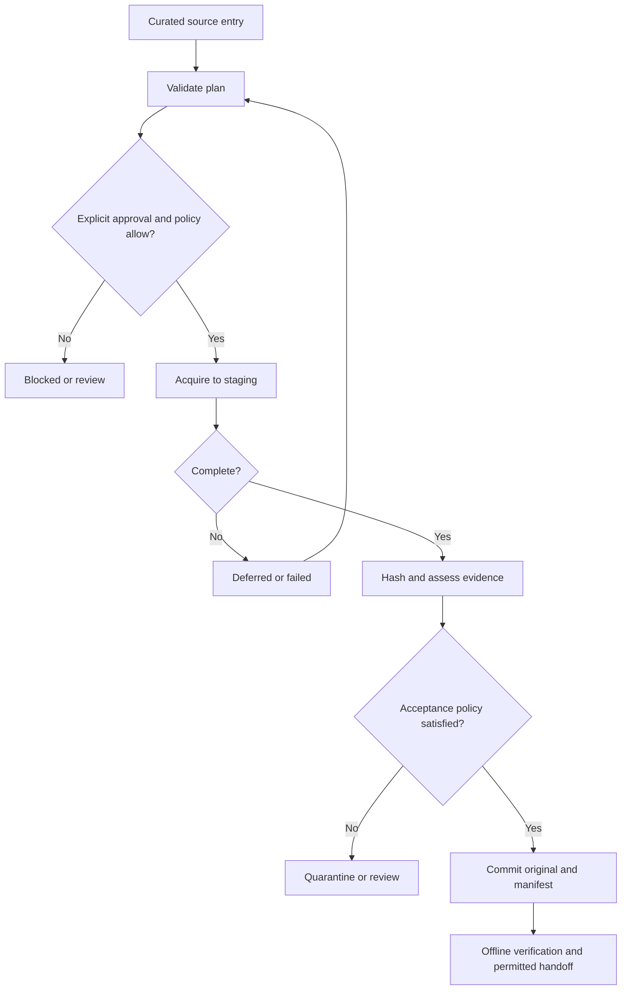

# SASD-HSAT — Requirements Specification

**Historical Software Acquisition Toolkit**  
**Document:** REQUIREMENTS.md  
**Revision:** 0.1 (initial draft)  
**Date:** 2026-11-27  
**Status:** Proposed requirements baseline — owner review required  
**Language:** English (primary)  
**Project:** SASD — Scientific and Software Development

> Start small, think big, and deliver continuous value.

## 1. Purpose and document control

This document describes what HSAT must accomplish, the boundaries of the first useful release, the long-term research platform, and the evidence needed to accept each capability. It is a requirements specification, not an implementation assignment, architecture decision record, legal opinion or claim of existing functionality.

The project is currently documented in the [SASD Historical Software Archive](https://github.com/Robin-Goerlach/SASD-Historical-Software-Archive). A dedicated SASD-HSAT implementation repository is proposed at https://github.com/Robin-Goerlach/SASD-HSAT; its creation and the final repository boundary remain open. This document is portable between the two repositories. The [Automating UNIX SysAdmin](https://github.com/Robin-Goerlach/Automating_Unix_SysAdmin) project is the first intended consumer.

Normative language: SHALL means mandatory for the indicated scope once the requirement is approved; SHOULD means a recommended target subject to an explicit documented exception; MAY indicates an option. Requirement identifiers are stable and must not be reused after retirement. The release column **0.1** denotes proposed mandatory acceptance requirements for the first release; **Later** denotes the target platform and is not an authorization to implement it. Numeric policy targets are proposals until approved. All requirements are currently unimplemented/unverified unless independently demonstrated; no test results are implied.

Future companion documents: VISION.md, ROADMAP.md, ARCHITECTURE.md, SECURITY.md, AGENTS.md, ARCHIVE-POLICY.md, NETWORK-POLICY.md, SOURCES.md, and a test/traceability specification. These are planned, not claimed to exist.

## 2. Strategic objectives

Two equally important objectives guide the project:

1. We want not merely to get historical UNIX programs running again, but to establish a reproducible research environment spanning several decades of UNIX system administration.
2. Acquisition, preservation, provisioning and validation of historical software should be automated to the extent that researchers can focus on investigation and development rather than repetitive infrastructure work.

HSAT is intended to become reusable SASD infrastructure, not a disposable script tied to one repository. Success means that another authorized researcher can understand where an artifact came from, what is known and unknown about it, retrieve an approved copy, reconstruct a documented environment and repeat a recorded experiment. Failed searches and failed reconstructions are valid research outcomes.

The first research domain includes configuration management, monitoring, network services, file services, backup, databases and UNIX/Linux administration tools. Other historical systems may be supported later without changing the fundamental provenance model.

## 3. Stakeholders, system boundary and terminology

| Stakeholder | Need |
| --- | --- |
| Project owner | Scope, budget, risk, architecture decisions and release approval |
| Researcher / system administrator | Locate and acquire historical versions; repeat experiments |
| Archive operator | Maintain integrity, provenance, storage and lawful access |
| Rights / security reviewer | Evaluate authorization, restrictions and execution risk |
| Consumer project | Receive verifiable offline inputs without duplicating acquisition logic |
| Developer / agent (including Codex) | Implement bounded assignments, tests and documentation |
| External archive operator | Predictable, respectful access without excess load |
| Future contributor | Understand schemas, behavior, evidence and contribution boundaries |

Roles may be performed by one person in 0.1; the conceptual distinction does not imply a user-management system in the first release.

| Term | Meaning |
| --- | --- |
| Source | An identified upstream or mirror location, catalog reference or lawful local medium |
| Candidate | A possible item found through research, not yet authorized for acquisition |
| Release | A software version/edition with historical context |
| Artifact | A byte stream such as source archive, binary, patch, manual, checksum or disk image |
| Provenance | Evidence of origin, retrieval, custody, transformations and uncertainty |
| Manifest | Versioned machine-readable description of items, events and evidence |
| Staging | Incomplete or not yet assessed acquisition data |
| Quarantine | Material withheld from normal consumption due to uncertainty, failure or suspicion |
| Accepted artifact | Complete, locally hashed material admitted under policy; not necessarily authentic or redistributable |
| Upstream-verified | A match against an approved independent expected value or supported signature, with method and evidence stated |
| CAS | Content-addressed storage; objects keyed by content digest |
| Research environment | Documented OS, architecture, toolchain, dependencies and configuration |
| Reproduction manifest | Pinned inputs, recipes and environment details for repeating an experiment |

The archive initiative owns the preservation and research goals; HSAT supplies tooling. The public source repository contains code, documentation and publishable metadata, not unrestricted third-party bytes. External archives, network, storage backends and laboratory platforms are dependencies with explicit interfaces and policies. HSAT does not grant legal permissions or guarantee authenticity.

## 4. Release boundaries and principal use cases

### 4.1 HSAT 0.1 — deliberately small, practical acquisition tool

A single operator provides a curated source list, previews a plan, explicitly authorizes the selected transfer, acquires files with enforced network limits, verifies and records what is known, and makes permitted material available offline. A local filesystem and simple versioned interchange formats are sufficient. The first release should be usable before full platform design is implemented.

In scope: local CLI; curated list and policy validation; explicitly selected HTTPS transfers; controlled rate, request and volume; staging, safe resume/restart and duplicate avoidance; SHA-256 and optional expected checksum/size; manifest, audit and error reporting; quarantine and local verification; documented offline handoff; tests and basic backup/restore procedure.

Out of scope for 0.1: generalized autonomous Internet discovery, broad crawling, SQL server, public download service, complex multi-user or distributed scheduling, full content-addressed storage service, archive extraction, compilation, installation, VM/emulator control, automatic dependency resolution, research dashboard and unattended publication. Signature verification and extra transports are future capabilities unless separately approved as a narrowly justified scope change. No automatic execution of downloaded material.

### 4.2 Complete platform

The future platform should support the research lifecycle: discover → assess rights and provenance → approve → acquire → verify → catalog → preserve → resolve dependencies → build → install → validate → publish permitted evidence. Each transition has explicit state, policy and evidence; no step implies permission for the next. A missing item, an unresolved license or an unsuccessful build can terminate or defer a workflow without hiding the result.

### 4.3 Use cases and failure paths

| ID | Actor and scenario | Expected outcome |
| --- | --- | --- |
| UC-01 | Operator prepares approved source list | Validated plan; no network in preview |
| UC-02 | Operator acquires a selected historical release | Complete original bytes, recorded hash and evidence |
| UC-03 | Network interruption or daily budget exhaustion | Safe deferral; persistent state and budget; no false success |
| UC-04 | Upstream changes content or provides a bad checksum | Reject unsafe resume or quarantine; record conflict |
| UC-05 | Operator repeats a completed batch | Verified local reuse; no unnecessary downloads |
| UC-06 | Consumer requests offline files | Permitted artifact and portable manifest; no execution |
| UC-07 | Archive operator detects corruption | Local verification failure; blocked reuse; documented recovery |
| UC-08 | Researcher investigates early CFEngine or monitoring releases | Later: candidates, historical dependency evidence and reproducible experiment |
| UC-09 | Source owner imposes restrictions | Denied/deferred requests; no evasion |
| UC-10 | Reviewer receives rights correction | Block prohibited acquisition/export; retain permissible audit evidence |
| UC-11 | Future agent proposes a new source or build | Proposal only until policy/authorization permits execution |

### 4.4 Core workflow and invariants

Conceptual item states: candidate, planned, blocked, approved, acquiring, paused/deferred, failed, staged, review/quarantined, accepted, and invalidated. Exact persisted state machine and atomic transitions are design deliverables. Acceptance requires complete bytes, durable metadata, policy approval and all required checks. Unknown upstream authentication is not the same as failure; it must remain explicit and is acceptable only under an approved policy. Rights, acquisition completion, integrity, authenticity and research validation are distinct dimensions, not a single success flag.

Every side effect must be authorized; every accepted object must have a recoverable manifest; every transfer must obey its effective network policy; original bytes must never be silently changed; every experiment must identify its evidence and uncertainties.

## 5. Project governance and scope

| ID | Scope | Requirement | Verification / acceptance evidence |
| --- | --- | --- | --- |
| HSAT-GOV-001 | 0.1 | The project shall pursue both strategic goals in Section 2; acquisition convenience shall not override research evidence, lawful access or preservation. | Review the approved scope and pilot results. |
| HSAT-GOV-002 | 0.1 | Each implementation assignment shall identify its authorized release, requirements, permitted changes and acceptance evidence. This requirements document alone shall not authorize implementation, network acquisition, publication or execution. | Inspect an assignment and demonstrate denial of an unapproved operation. |
| HSAT-GOV-003 | 0.1 | The first release shall be independently useful without any database server, web UI, background service, VM infrastructure or generalized discovery engine. | Install and run the pilot on a clean reference host without those services. |
| HSAT-GOV-004 | 0.1 | HSAT shall be reusable by independent consumer projects and shall not require a checkout of Automating UNIX SysAdmin. | Acquire an approved fixture from a stand-alone installation. |
| HSAT-GOV-005 | Later | A maintainer shall be able to assign independent project collections, storage and access policies without duplicating the entire platform. | Demonstrate two logically separate research collections. |
| HSAT-GOV-006 | 0.1 | Changes to approved requirements, scope and default network policy shall be version controlled, reviewed and traceable; an agent shall not silently expand its mandate. | Inspect change history and review records. |

## 6. Source identification and research

| ID | Scope | Requirement | Verification / acceptance evidence |
| --- | --- | --- | --- |
| HSAT-SRC-001 | 0.1 | The operator shall supply a curated, versioned list of explicitly selected artifact URLs. No automatic crawling, search-engine scraping or directory traversal shall be required in 0.1. | Process a local fixture list and inspect the outbound requests. |
| HSAT-SRC-002 | 0.1 | Every source entry shall identify a stable item ID, project, requested release or explicitly unknown version, original filename, URL, source reference and rights-review status; expected size and checksums shall be optional. | Validate complete and incomplete examples. |
| HSAT-SRC-003 | 0.1 | The input shall distinguish unknown, inferred and confirmed information; missing release dates or checksums shall not be invented. | Inspect a record with unknown date and digest. |
| HSAT-SRC-004 | 0.1 | Invalid, conflicting or ambiguous input shall be rejected before network activity, including duplicate IDs with inconsistent metadata, unsupported URL schemes and unsafe paths. | Run negative fixtures with a network observer. |
| HSAT-SRC-005 | 0.1 | The operator shall be able to select a single item or an explicit batch, and associate it with a research project or acquisition request. | Select subsets and verify the resolved plan. |
| HSAT-SRC-006 | Later | Discovery adapters shall search individually approved project archives, mirrors, distribution repositories, indexes and bibliographic references with recorded query, source, time, evidence and policy. | Run deterministic adapter fixtures and review resulting candidates. |
| HSAT-SRC-007 | Later | The catalog shall retain source relationships, mirror observations, availability history and conflicting descriptions without treating a mirror as automatically authoritative. | Import competing source descriptions. |
| HSAT-SRC-008 | Later | A discovery result shall remain a candidate until reviewed or accepted under an explicit standing policy. Automated discovery shall never imply permission to download. | Demonstrate candidate generation without acquisition. |
| HSAT-SRC-009 | Later | The platform shall support targeted rediscovery of missing artifacts and links without repeatedly fetching unchanged content or circumventing source limits. | Demonstrate bounded rechecks with fixtures. |

## 7. Acquisition and operational workflow

| ID | Scope | Requirement | Verification / acceptance evidence |
| --- | --- | --- | --- |
| HSAT-ACQ-001 | 0.1 | HSAT shall provide a documented command-line interface to validate input, preview a plan, acquire a selected item or batch, inspect status and verify locally stored files. Command names are deferred. | Exercise all operations through documented invocations. |
| HSAT-ACQ-002 | 0.1 | Dry-run shall make no network requests and no archive mutations; it shall report selections, missing metadata, rights and policy decisions, expected sizes where known, and anticipated destinations. | Compare filesystem state and capture network traffic. |
| HSAT-ACQ-003 | 0.1 | Actual acquisition shall require an explicit execution request and an approved source/item policy. An invalid or unapproved selection shall fail closed. | Try a denied and an approved item. |
| HSAT-ACQ-004 | 0.1 | The initial supported remote transport shall be HTTPS; other protocols, including historical FTP or HTTP, require a separately approved source-specific policy and design before support is enabled. Local HTTP fixtures may use a test-only configuration. | Reject insecure production transport; exercise permitted local fixtures. |
| HSAT-ACQ-005 | 0.1 | Transfers shall stream into staging rather than buffering complete artifacts in memory or writing directly into the accepted archive. | Observe a large generated test file during transfer. |
| HSAT-ACQ-006 | 0.1 | The tool shall support a persistent per-item state, safe stop on operator request and restart after an interrupted process, without exposing partial files as complete. | Interrupt and restart at several transfer boundaries. |
| HSAT-ACQ-007 | 0.1 | Partial transfer resumption shall require reliable remote identity validation, a valid range response and matching offsets. Otherwise restart from zero or report a recoverable failure; never append uncertain bytes. | Test matching and changed validators, ignored ranges and invalid Content-Range. |
| HSAT-ACQ-008 | 0.1 | Repeated execution shall skip an already accepted artifact only after checking its identity, policy and local integrity. A filename alone shall never establish a match. | Repeat a batch and tamper with a local object. |
| HSAT-ACQ-009 | 0.1 | An acquisition shall never silently overwrite an existing accepted artifact or conflicting filename; conflicting bytes shall be recorded separately for review. | Serve two different bodies for one filename. |
| HSAT-ACQ-010 | 0.1 | Batch processing shall distinguish item success, skip, review, deferral and failure; errors shall not be masked by a successful later item. | Run a mixed batch and inspect statuses and exit result. |
| HSAT-ACQ-011 | 0.1 | Before and during acquisition the tool shall enforce configurable item-size, staging-volume and free-space limits, including responses with absent or false Content-Length. | Use a small test quota, chunked responses and simulated disk exhaustion. |
| HSAT-ACQ-012 | 0.1 | The tool shall expose actionable diagnostics for missing files, permission failures, timeout, network errors, policy denial, integrity failure and storage failure. | Inject each failure and inspect error category. |
| HSAT-ACQ-013 | Later | The platform shall support approved local-media import with provenance, without treating an imported file as necessarily authentic. | Import a local fixture twice and verify provenance. |
| HSAT-ACQ-014 | Later | Persistent priority queues, scheduling, approved multiple workers and dependency-aware planning shall share the same policy and budget controls. | Demonstrate scheduling and shared limits across workers. |
| HSAT-ACQ-015 | Later | An operator shall be able to suspend a source, cancel a job and revoke future acquisition authorization without losing its audit history. | Revoke a source during a queued workflow. |

## 8. Network responsibility and resource limits

| ID | Scope | Requirement | Verification / acceptance evidence |
| --- | --- | --- | --- |
| HSAT-NET-001 | 0.1 | All acquisition traffic within one configured HSAT installation shall be subject to an aggregate application-level byte-rate limit and shared transfer-volume budget, not merely a per-file setting. | Measure two competing invocations and retries against one shared budget. |
| HSAT-NET-002 | 0.1 | Only one active transfer shall be permitted by the initial policy; concurrent invocations sharing the archive shall serialize or fail safely. An unsupported multi-host shared archive shall be refused or explicitly outside the supported deployment. | Start concurrent processes and inspect request overlap. |
| HSAT-NET-003 | 0.1 | The effective policy shall be the most restrictive combination of global limits, source limits and the approved request. Invalid or missing required limits shall prevent transfers. | Attempt to override a stricter source policy. |
| HSAT-NET-004 | 0.1 | Rate limiting shall be effective across partial, resumed, failed and redirected transfers, including error response bodies that are read. The implementation shall document measurement boundaries and bounded burst allowance. | Measure sustained and short-window transfer rates using a local server. |
| HSAT-NET-005 | 0.1 | The volume counter shall include bytes actually received by the application, even if discarded; reservations or conservative accounting shall prevent a crash from restoring spent budget. An exhausted budget shall stop/defer work. | Interrupt near the quota and restart; test a failing transfer. |
| HSAT-NET-006 | 0.1 | Every request to an origin, including redirect hops, retries and preflight requests, shall consume the relevant request allowance and observe minimum spacing; unknown redirect destinations shall require policy approval before contact. | Record timestamps and destination hosts from redirect fixtures. |
| HSAT-NET-007 | 0.1 | The tool shall honor Retry-After, apply bounded retry/backoff and distinguish transient from permanent errors. Access denial, authentication challenge or source prohibition shall not trigger evasion or automatic mirror rotation. | Test 429, 503, 401, 403, 404 and redirect loops. |
| HSAT-NET-008 | 0.1 | Connect, read-idle and overall attempt timeouts and redirect depth shall be finite and configurable; stalled requests shall not block the installation indefinitely. | Use delayed, stalled and looping fixtures. |
| HSAT-NET-009 | 0.1 | A descriptive user agent and source-specific contact identifier shall be configurable where appropriate; source rules and access restrictions shall be respected. | Inspect headers and a denied source rule. |
| HSAT-NET-010 | 0.1 | The tool shall neither rotate identities to evade restrictions nor disable TLS certificate validation globally. No unattended public Internet crawling shall be part of the initial release. | Inspect configuration and negative tests. |
| HSAT-NET-011 | Later | Distributed deployments shall enforce shared cross-host quotas or partition non-overlapping budgets explicitly; deployment shall not claim a global cap without evidence. | Test multiple nodes including loss of coordinator. |

## 9. Integrity, identity and trust

| ID | Scope | Requirement | Verification / acceptance evidence |
| --- | --- | --- | --- |
| HSAT-VER-001 | 0.1 | Compute SHA-256 and exact byte count over the original completed byte stream before acceptance. | Compare a known fixture against independent hash and size tools. |
| HSAT-VER-002 | 0.1 | If an approved expected SHA-256 or expected size is present, compare it and record expected and actual values and evidence source. Mismatch shall prevent acceptance. | Use correct and incorrect values. |
| HSAT-VER-003 | 0.1 | Locally computed hashes shall establish a baseline for later integrity checks, not upstream authenticity. Missing upstream evidence shall be explicit, never labeled verified against upstream. | Inspect a download without expected digest. |
| HSAT-VER-004 | 0.1 | Verification shall separately represent transfer completeness, local hash recorded, expected digest match/mismatch, signature status and authenticity confidence; unsupported or unattempted checks shall be reported as such. | Inspect records for all supported outcomes. |
| HSAT-VER-005 | 0.1 | Incomplete, mismatched or suspicious material shall remain unavailable to normal accepted-artifact consumers. Retention in quarantine requires an authorized storage policy. | Attempt offline access through the normal interface. |
| HSAT-VER-006 | 0.1 | Accepted local files shall be re-verifiable without Internet access; corruption shall be reported and block normal reuse until repaired through an approved workflow. | Change one byte and run offline verification. |
| HSAT-VER-007 | Later | Verify supported upstream signatures against independently reviewed trust anchors and record key fingerprint, provenance and verification result; a signature obtained with an artifact is not by itself proof of trust. | Test good, bad, unknown and revoked keys. |
| HSAT-VER-008 | Later | Compare independently acquired copies and preserve evidence conflicts, rather than assuming the majority is authentic. | Import differing mirrors and compare records. |

## 10. Catalog, metadata and provenance

| ID | Scope | Requirement | Verification / acceptance evidence |
| --- | --- | --- | --- |
| HSAT-CAT-001 | 0.1 | Produce a documented machine-readable, versioned manifest and human-readable result log for each acquisition, independent of the source-list format. | Validate output against the documented schema. |
| HSAT-CAT-002 | 0.1 | Record item ID, project/release, original filename, requested/effective source URL with secret redaction, UTC timestamps, tool version, local object reference, received bytes, size/hash evidence, rights decision, state and error category as applicable. | Inspect a successful and unsuccessful attempt. |
| HSAT-CAT-003 | 0.1 | Separate acquisition attempts from artifact records; a retry, alternate source or failure shall not erase earlier evidence. | Acquire identical bytes through two approved sources. |
| HSAT-CAT-004 | 0.1 | Use stable identifiers and explicitly version the interchange schema. Reject unsupported incompatible schema versions with diagnostics. | Test known and unknown schema versions. |
| HSAT-CAT-005 | 0.1 | Historical release dates shall remain distinct from observation and retrieval dates and support uncertain dates or unknown values. | Round-trip historical and unknown dates. |
| HSAT-CAT-006 | 0.1 | A manifest and its referenced files shall be independently usable offline without private credentials or reliance on the original URL. | Copy an approved bundle to an offline host. |
| HSAT-CAT-007 | Later | The catalog shall model projects, releases, sources, observations, artifacts, rights, acquisitions, verifications, dependencies, environments, experiments and derivatives as separate related entities. | Review the conceptual model and run round-trip tests. |
| HSAT-CAT-008 | Later | Search shall support project, version, platform, architecture, date/range, artifact type, rights, provenance and integrity filters; unknown values shall remain searchable. | Query a representative fixture catalog. |
| HSAT-CAT-009 | Later | Support migration, import and export with referential integrity, change history, stable IDs and a documented recovery strategy independent of the chosen database. | Migrate a fixture catalog and compare normalized records. |
| HSAT-CAT-010 | Later | Conflicting metadata shall be representable with evidence, reviewer and resolution history, not overwritten without trace. | Record two incompatible release dates. |

## 11. Archive storage and preservation

| ID | Scope | Requirement | Verification / acceptance evidence |
| --- | --- | --- | --- |
| HSAT-ARC-001 | 0.1 | The configured archive root shall be separate from the public Git checkout by default; runtime artifacts, restricted content, credentials and logs shall not be committed. | Inspect a default installation and its Git working tree. |
| HSAT-ARC-002 | 0.1 | Staging, accepted material and quarantined material shall be logically separated and protected against ordinary consumers accidentally using incomplete bytes. | Inspect access after success, failure and interruption. |
| HSAT-ARC-003 | 0.1 | Acceptance shall be crash-consistent: original bytes and committed metadata shall agree after restart; an incomplete transaction shall be recoverable or flagged, never presented as successful. | Inject failure before and after finalization and manifest updates. |
| HSAT-ARC-004 | 0.1 | Original bytes shall remain unchanged; accepted artifacts shall not be edited in place by normal operations. Reacquisition or repair shall retain an audit record. | Attempt replacement and verify original digest. |
| HSAT-ARC-005 | 0.1 | The operator shall be able to inventory and locally verify archive contents and identify missing, corrupt or unreferenced items. | Create orphan and missing-file fixtures. |
| HSAT-ARC-006 | 0.1 | The operator shall receive documented backup and restore procedures for artifacts, metadata and policy state; a small test archive shall be restorable and verifiable. | Restore to a clean directory and validate manifest/object consistency. |
| HSAT-ARC-007 | Later | A storage abstraction shall support content-addressed objects, deduplication by digest and independent provenance records for identical bytes. | Store one object from two sources and retain two observations. |
| HSAT-ARC-008 | Later | Support scheduled integrity audits, independent backup copies, restore drills, migration and controlled retention/deletion with documented audit exceptions. | Simulate corruption and perform tested restoration. |
| HSAT-ARC-009 | Later | Derived files shall carry independent identity, parent references, transformation recipe and tool versions; the original object shall remain distinguishable. | Unpack or patch a fixture and inspect the lineage. |

## 12. Rights, licensing and publication

| ID | Scope | Requirement | Verification / acceptance evidence |
| --- | --- | --- | --- |
| HSAT-RGT-001 | 0.1 | Acquisition, retention, use and redistribution permissions shall be recorded independently; public accessibility, old age or abandonware labeling shall not imply permission. | Inspect rights records with differing permissions. |
| HSAT-RGT-002 | 0.1 | Unknown or conflicting authorization to acquire or retain shall block acquisition until resolved. Unknown redistribution rights shall block external publication even if internal retention is permitted. | Try all combinations of rights states. |
| HSAT-RGT-003 | 0.1 | Each positive rights decision shall reference evidence and its scope, reviewer or approved policy, and review date. The tool shall not claim legal certainty merely from metadata. | Review approved and incomplete records. |
| HSAT-RGT-004 | 0.1 | Preserve original license and copyright notices where available; project MIT licensing shall not be applied to third-party artifacts. | Inspect a fixture with a separate upstream license. |
| HSAT-RGT-005 | 0.1 | Normal export shall require permitted recipients/use and shall exclude restricted bytes and sensitive metadata. Metadata-only references may be published only if separately permitted. | Attempt export with mixed rights and sensitive fields. |
| HSAT-RGT-006 | Later | Support correction, restriction, takedown and retention review workflows including export revocation where feasible, without promising removal of copies outside SASD control. | Exercise a simulated takedown and audit trail. |
| HSAT-RGT-007 | Later | The platform shall support access-restricted collections for lawfully retained material, with no assumption that preservation exceptions apply universally. | Demonstrate distinct access scopes and denied retrieval. |

## 13. Offline provisioning and research reconstruction

| ID | Scope | Requirement | Verification / acceptance evidence |
| --- | --- | --- | --- |
| HSAT-REP-001 | 0.1 | Provide a documented offline handoff consisting of approved local files or stable local references, a manifest, relevant rights notices and checksums, without automatically installing or executing software. | Use the handoff from a disconnected consumer host. |
| HSAT-REP-002 | 0.1 | A first pilot shall support an actual acquisition need of Automating UNIX SysAdmin, using only separately approved sources and quantities; specific release versions are not fixed by this document. | Review pilot evidence and a consumer handoff. |
| HSAT-REP-003 | Later | Model historically applicable operating systems, architectures, compilers, libraries, packages, build tools, patches, documentation and configuration dependencies with evidence and uncertainty. | Resolve a fixture with a missing and conflicting dependency. |
| HSAT-REP-004 | Later | Dependency resolution shall preserve explicit gaps and distinguish original, contemporaneous, compatible substitute and modern replacement; substitution requires recorded approval. | Attempt automatic substitution and inspect denial or recorded approval. |
| HSAT-REP-005 | Later | Produce permitted offline package sources or bundles with pinned hashes, dependency information and a portable manifest. | Reconstruct a fixture bundle without networking. |
| HSAT-REP-006 | Later | Record build recipes, commands, environment, inputs, tool versions, outputs, logs, separately applied patches and failures. | Repeat a build using pinned inputs. |
| HSAT-REP-007 | Later | Install and configure in approved isolated VM/emulator environments using versioned recipes and record configuration, snapshots, errors and deviations from historical sources. | Reconstruct a reference environment from a manifest. |
| HSAT-REP-008 | Later | Execute approved functional and integration tests, record expected and actual behavior, capture negative outcomes and distinguish observation from interpretation. | Run a reference test with both successful and failed cases. |
| HSAT-REP-009 | Later | Support exportable experiment manifests, reports and references to evidence, distinguishing bit-identical, functional and historical reproducibility. | Repeat an experiment and compare results with stated reproducibility class. |
| HSAT-REP-010 | Later | Compare releases, eras and operating environments, associate historical literature and administrator workflows, and preserve hypotheses, measurements and conclusions. | Produce a reproducible cross-version comparison. |

## 14. Security, privacy and authorization

| ID | Scope | Requirement | Verification / acceptance evidence |
| --- | --- | --- | --- |
| HSAT-SEC-001 | 0.1 | Run acquisition with least privilege and without root privileges in normal operation. Separate archive access from development and deployment credentials. | Run as an ordinary account and inspect permissions. |
| HSAT-SEC-002 | 0.1 | Treat all source content and metadata as untrusted data, including text that attempts to instruct an agent. No downloaded material shall execute during acquisition, verification or normal handoff. | Use a fixture containing executable code and adversarial text. |
| HSAT-SEC-003 | 0.1 | Constrain all file operations to authorized roots; reject traversal, absolute output paths, unsafe symlinks, hardlink conflicts, special files and race-prone destinations. Do not follow untrusted links when writing. | Run a suite of filesystem attack fixtures and verify outside files unchanged. |
| HSAT-SEC-004 | 0.1 | Validate destination URLs and redirects against approved schemes/origins and block unintended access to loopback, private/link-local addresses and metadata services in production; separately scoped local test fixtures are allowed. Revalidate resolved targets to prevent DNS rebinding. | Exercise disallowed destinations, redirect and DNS fixtures. |
| HSAT-SEC-005 | 0.1 | Verify TLS certificates and hostnames by default; no silent downgrade or insecure fallback. Legacy protocol support requires explicit threat review and constrained authorization. | Use bad certificates and downgrade redirects. |
| HSAT-SEC-006 | 0.1 | Never write credentials, tokens, cookies, private keys or sensitive query values into public manifests, logs, command examples or Git history; fail safely when redaction cannot preserve intended privacy. | Inject dummy secrets and scan outputs. |
| HSAT-SEC-007 | 0.1 | Policy shall distinguish proposal, authorization and execution, bind approvals to the selected plan and applicable policy, and deny actions outside the approved scope. | Change a selected item or policy after approval and test denial. |
| HSAT-SEC-008 | 0.1 | Operational audit records shall identify significant decisions and failures, and the tool shall not silently fabricate missing evidence after interruption. | Interrupt a run and inspect recovery records. |
| HSAT-SEC-009 | Later | Archive extraction shall be separately authorized and constrained by path, link, file-count, decompression-ratio and resource limits; derived content shall not replace original bytes. | Test malicious archive fixtures in isolation. |
| HSAT-SEC-010 | Later | Build and installation shall execute only in approved disposable isolated VMs or emulators with restricted network, no host credentials, bounded resources and controlled import/export. Containers alone shall not be the default boundary for unknown historical OS images or binaries. | Verify isolation and run a safe negative fixture. |
| HSAT-SEC-011 | Later | Support role separation for researchers, reviewers, operators, archive administrators and publication approvers with scoped authorization and revocation. | Demonstrate cross-role denial and audit events. |
| HSAT-SEC-012 | Later | Agent-assisted research shall enforce the same policy as human requests and require approval for new source scope, raised budgets, code execution and external publication. | Attempt agent-initiated out-of-scope requests. |

## 15. Non-functional and quality requirements

| ID | Scope | Requirement | Verification / acceptance evidence |
| --- | --- | --- | --- |
| HSAT-NFR-001 | 0.1 | The first release shall support a documented contemporary Linux reference environment; Debian 12/WSL2 is the proposed initial development baseline, subject to confirmation. Historical operating systems are research targets, not required HSAT hosts. | Run the complete suite in the approved reference environment. |
| HSAT-NFR-002 | 0.1 | Normal use shall not require a database server, privileged daemon, graphical interface, commercial service or cloud account. | Perform a clean offline-capable installation and local run. |
| HSAT-NFR-003 | 0.1 | Transfer memory shall remain bounded independently of artifact size, and the tool shall not load the full batch of artifact bytes into memory. | Measure memory during a generated large transfer. |
| HSAT-NFR-004 | 0.1 | Failures shall be explicit, recoverable where possible and produce stable documented exit semantics suitable for shell automation; partial batch failure shall not report unconditional success. | Exercise automated shell consumers and mixed results. |
| HSAT-NFR-005 | 0.1 | The CLI shall provide help, version information, meaningful errors and noninteractive operation when an approved plan is supplied; it shall never silently assume approval in unattended mode. | Run help and unattended positive/negative tests. |
| HSAT-NFR-006 | 0.1 | Configuration and input formats shall be documented, validated and deterministic; effective limits shall be inspectable before transfer. | Compare repeated plan outputs excluding explicitly volatile fields. |
| HSAT-NFR-007 | 0.1 | Tests shall use deterministic local fixtures, cover failure injection and avoid routine dependencies on public historical servers. Any live pilot shall be separate and explicitly approved. | Run CI with external networking disabled. |
| HSAT-NFR-008 | 0.1 | Design shall separate domain and policy logic from transport, storage and presentation sufficiently to permit later backend or adapter replacement; avoid premature distributed infrastructure. | Review interfaces and dependency boundaries in the design. |
| HSAT-NFR-009 | 0.1 | Publish English user/developer documentation and maintain German equivalents for major project and operator documents before the first release; this English requirements draft is intentionally the first document. | Review documentation completeness and examples. |
| HSAT-NFR-010 | 0.1 | Dependencies, license compatibility, installation steps and version requirements shall be documented; avoid unsupported claims about build reproducibility or security. | Inspect dependency inventory and fresh installation evidence. |
| HSAT-NFR-011 | 0.1 | The release shall include a repeatable test command, versioned release notes, known limitations and a traceability record from approved mandatory requirements to tests or review evidence. | Audit the release candidate. |
| HSAT-NFR-012 | Later | Scale targets for catalog size, concurrent clients, storage growth, recovery time and throughput shall be defined from measured 0.1 workload before expanding infrastructure; no arbitrary production scale claim shall be made. | Review measurements, load tests and agreed targets. |
| HSAT-NFR-013 | Later | Provide optional stable API and search UI without removing the CLI or requiring a centralized server for stand-alone workflows. | Demonstrate equivalent authorized operations through interfaces. |

## 16. Proposed initial operating policy (requires approval)

Values follow the initial README proposal where available. Additional values below are engineering proposals, not binding decisions. Source restrictions always take precedence when stricter. The operator must approve effective settings before any real-world pilot.

| Control | Proposed default / rule | Rationale |
| --- | --- | --- |
| Aggregate received body rate | 256 KiB/s (262144 bytes/s) | Modest sustained load |
| Active transfers | 1 per installation | Avoid parallel load and simplify correctness |
| Daily application body budget | 10 GiB (10737418240 bytes) | Bound volume, including failed/retried bytes |
| Budget accounting window | UTC calendar day, persisted; no reset on process restart | Transparent accounting |
| Per-origin request spacing | At least 5 seconds between request starts | Avoid rapid metadata/retry requests |
| Retries | At most 3 after initial attempt | Finite failure handling |
| Retry delay | Proposed 5, 15, 45 seconds minimum; honor longer Retry-After | Reduce repeated server pressure |
| Redirect depth | Proposed maximum 5 | Bound loops and policy checks |
| Connect / read idle timeout | Proposed 15 / 60 seconds | Detect unavailable or stalled servers |
| Overall attempt timeout | Proposed 24 hours, configurable | Accommodate large approved artifacts at limited rate |
| Max item / staging / minimum free space | Must be explicitly configured for pilot; no unbounded setting | Protect storage |
| Protocol | HTTPS initially; localhost HTTP only for scoped testing | Avoid unsafe default transport |
| Maximum burst and accounting tolerance | Proposed at most 64 KiB application body burst; validate using controlled fixtures | Effective rate, not only nominal setting |

Rate and quota are expressed in binary units (KiB/GiB). The application counts response-body bytes actually read, including errors and resumed transfers, and documents the distinction from wire-level TLS/IP overhead; it must not claim to measure total wire bytes. An optional external traffic shaper may impose a stricter wire-level bound. For any measured interval of duration t seconds, the proposed application pacing bound is rate × t plus the approved burst allowance; the implementation design must account for buffering and measure actual delivery. A failed attempt consumes its received bytes. Reserve budget before reads or conservatively debit bounded chunks to prevent overshoot and restart loopholes. UTC rollover must not be exploitable through clock rollback; document trusted time assumptions, conservative recovery and policy for an unavailable counter.

At 256 KiB/s the daily budget would permit about 11 hours and 23 minutes of sustained full-rate body transfer, so the volume cap is meaningful even for long unattended runs. This does not grant permission to run that long against any particular server. Unknown source policy or unavailable accounting must result in a safe stop. An explicit, reviewed configuration can reduce any limit; raising defaults or enabling more workers requires separate approval.

## 17. Minimum conceptual interchange model

This section specifies information requirements, not a final JSON/TSV grammar or SQL schema.

| Record | Minimum information |
| --- | --- |
| Source entry | Stable ID, project, requested version or unknown, original filename, source URL/reference, rights decision/reference, optional expected size/digest and notes |
| Plan | Selected IDs, resolved destination references, effective policy/version, input digest, approval reference, scope and creation time |
| Attempt | ID, item and plan references, start/end UTC, requested/effective sanitized URLs, bytes received, outcome, retry/redirect observations, tool version, error category |
| Artifact | Stable ID, original filename, object locator, exact byte size, SHA-256, acceptance state, provenance references |
| Verification | Artifact/attempt ID, algorithm, expected/observed values, evidence source, outcome, UTC time |
| Rights | Scope for acquisition/retention/use/distribution, decision, reviewer/policy, evidence reference, date |
| Budget | Accounting window, consumed/reserved bytes, applicable policy, recovery status |
| Export | Artifact and manifest references, permitted audience/use, notices, hashes, export event |

The design must define required/optional fields, supported types and limits, escaping and character encoding, schema version negotiation, atomic update strategy, secret-safe URL representation, uniqueness, path normalization and relationships. Preserve original release labels without forcing modern semantic versioning. Use explicit unknown values rather than invented dates. IDs and schemas must permit a future catalog migration without loss of provenance. A simple file format is adequate for the pilot; a final database choice is deliberately deferred.

## 18. Acceptance and verification plan

All 0.1 requirements must be mapped to individual automated tests, demonstrations, design inspections or documented operating procedures before release. The following acceptance scenarios are a minimum integrated test set, not substitutes for requirement-level traceability.

| Test ID | Scenario | Expected evidence | Primary requirement groups |
| --- | --- | --- | --- |
| AT-01 | Clean install and stand-alone CLI | Documented setup, help, exit behavior and test run without DB/service | GOV, NFR, ACQ |
| AT-02 | Valid/invalid list and dry-run | Deterministic plan; zero network and archive changes; invalid entries rejected | SRC, ACQ, SEC |
| AT-03 | Approved transfer with trusted expected hash | Exact bytes/size, matching hash, manifest and audit event | ACQ, VER, CAT |
| AT-04 | No upstream checksum | Local baseline only, explicit authenticity uncertainty, policy-dependent acceptance | VER, CAT |
| AT-05 | Truncation, wrong size/hash, corrupted local object | No false acceptance; quarantine/review and blocked offline use | VER, ARC |
| AT-06 | Interrupt, restart, changed upstream, malformed ranges | Safe resume/restart, exact bytes, no concatenation or duplicate approval bypass | ACQ, VER |
| AT-07 | Rate and concurrency limits | Timestamped controlled-server and application measurements; competing processes cannot exceed configured cap | NET |
| AT-08 | Quota across retries, interruption, restart and rollover | Persistent conservative accounting; no allowance reset or excess beyond approved semantics | NET, CAT |
| AT-09 | Redirect, 429/503, denial, timeout | Per-origin spacing; Retry-After; bounded retry; unauthorized redirect not contacted | NET, SEC |
| AT-10 | Disk shortage, unsafe paths/links and crash during commit | Outside files unchanged; no accepted partials; recoverable state | ACQ, ARC, SEC |
| AT-11 | Duplicate item / same filename different bytes | Verified skip or recorded conflict; no silent overwrite | ACQ, CAT, ARC |
| AT-12 | Rights and export boundaries | Unknown acquisition blocked; restricted export denied; no license substitution | RGT, REP |
| AT-13 | Secret and network-destination protection | Dummy secrets absent from output; prohibited URLs and rebinding rejected | SEC |
| AT-14 | Backup, restore and offline use | Restored metadata and hashes agree; consumer can use permitted files without network | ARC, REP, CAT |
| AT-15 | Real pilot | Separately approved small historical acquisition with source policy, actual transfer metrics, provenance and consumer handoff | GOV, SRC, REP, NET |
| AT-16 | Documentation and release audit | Version, known limits, dependency inventory, bilingual operator guidance, complete traceability | NFR, GOV |

For rate tests use a controllable fixture server, monotonic timing, a sufficiently long transfer, bounded burst windows, errors, redirects and concurrent invocations. For quota tests use intentionally small test budgets instead of consuming the real daily allowance. For crash tests inject faults at documented transaction boundaries and inspect actual disk state after restart. For security tests use harmless local fixtures, not public targets. Live tests are opt-in and never a routine CI dependency.

Release evidence shall include source commit, version, environment, configuration, fixture identifiers, commands, timestamps, results and known deviations. Record skipped tests and rationale; absence of evidence is not a pass. A real-source pilot cannot be used to waive failing local tests.

### 18.1 Definition of done for 0.1

- Owner approves requirements, effective initial policies, implementation scope and reference environment.
- Architecture/design decisions and input/manifest schemas are reviewed and documented.
- All mandatory 0.1 requirements have traceable passing evidence or an explicit owner-approved scope change; security, integrity, rights and network controls cannot be silently waived.
- Automated tests and controlled failure/recovery tests pass on the supported host; clean installation and offline operation are demonstrated.
- A separately authorized small real-world pilot supports an actual Retro UNIX administration need and produces a usable offline handoff.
- English and German operator documentation, release notes, known limitations, dependency notices and backup/restore instructions are present.
- Release is explicitly approved. No automatic promotion to the next milestone.

## 19. Evolution towards 1.0

The following capability groups are provisional sequencing, not a schedule or implementation approval.

| Stage | Intended outcome | Gate |
| --- | --- | --- |
| 0.1 | Practical bounded acquisition and offline handoff | Section 18 acceptance |
| 0.2 candidate | Searchable local catalog, migration and local imports | Schema and provenance integrity demonstrated |
| 0.3 candidate | Storage abstraction, CAS, integrity audit and recovery | Deduplication without provenance loss; restore proven |
| 0.4 candidate | Approved discovery adapters, source registry and scheduling | Source policies and aggregate budgets enforced |
| 0.5 candidate | Historical dependency graph and offline provisioning | Pinned artifacts and documented gaps |
| 0.6 candidate | Isolated build and installation recipes | Reconstructed environment and reproducible evidence |
| 0.7 candidate | Validation workflows and research comparisons | Repeatable experiments including negative findings |
| 0.8–0.9 candidates | Optional interfaces, multi-project integration, hardening, agent assistance | Scoped access, security and operational acceptance |
| 1.0 candidate | Stable end-to-end platform within explicitly approved support boundaries | Traceable acceptance of agreed 1.0 scope and documented exclusions |

Actual grouping and release numbers after 0.1 require separate roadmap approval. Each release must be independently useful and preserve portable data or provide an explicit migration path. No commitment to every possible future source, operating system or feature is implied by 1.0.

## 20. Open decisions and risks

| ID | Decision to be made | Required before |
| --- | --- | --- |
| OD-01 | Separate SASD-HSAT repository versus implementation in the archive repository; ownership of catalog and policies | Implementation assignment |
| OD-02 | Implementation language/runtime, packaging, reference Linux/WSL environment | Architecture 0.1 |
| OD-03 | Curated source list format, manifest schema, identifiers, CLI and exit code contract | Architecture 0.1 |
| OD-04 | Archive root layout, durable state mechanism, lock/transaction/recovery semantics | Implementation of acquisition |
| OD-05 | Confirm all network defaults, accounting, timeout, burst, disk and item limits | Live acquisition |
| OD-06 | Source registry, approved historical pilot items, evidence of rights, source-specific policy | Live acquisition |
| OD-07 | Authenticity acceptance policy when independent upstream digest or signature is absent | Artifact acceptance |
| OD-08 | Later catalog backend: versioned JSON/TSV in Git, SQLite, MySQL/MariaDB, PostgreSQL or another justified choice | Catalog expansion |
| OD-09 | Storage backend, backup targets, retention, rights-review and takedown responsibilities | Production archive |
| OD-10 | Legacy protocols, signature formats and trust anchor handling | Enabling those features |
| OD-11 | VM/emulator technology, isolated laboratory and evidence format | Reconstruction phase |
| OD-12 | Quantitative scale/recovery goals and multi-user deployment model | Distributed/platform expansion |

| Risk | Consequence | Mitigation |
| --- | --- | --- |
| Upstream disappearance | Missing historical evidence | Record failed discovery; lawfully preserve approved original bytes |
| Incorrect version or manipulated mirror | Invalid research conclusions | Provenance, independent evidence, explicit uncertainty |
| Excessive traffic | Harm to historical archives | Enforced aggregate limits, explicit scopes, stop on denial |
| Licensing ambiguity | Unauthorized retention or redistribution | Separate rights decisions and deny unknown permissions |
| Malicious or vulnerable historical code | Host/lab compromise | No execution in 0.1; isolated later execution and controlled import |
| Crash or disk corruption | False verification or lost artifacts | Staging, durable state, verification, backup and restore |
| Premature infrastructure complexity | Delayed practical value | Strict 0.1 boundary; evolve using measured needs |
| Schema/backend lock-in | Expensive migration or lost provenance | Stable identifiers, versioned interchange, explicit migration tests |
| Agent scope expansion | Unapproved changes or actions | Bounded assignments, independent authorization, review gates |
| Historical evidence gaps | Overstated conclusions | Document gaps, substitutions and negative findings |

## 21. Requirements maintenance and authorization

The project owner reviews this draft before it becomes an approved baseline. Subsequent changes shall preserve IDs, identify rationale, impacted tests and release scope, and record approval. Maintain the primary English requirements and a German counterpart when commissioned; translations must preserve normative strength and identifiers.

Before development, derive the 0.1 implementation specification (Pflichtenheft), security/network/archive policies, source registry, architectural decisions and detailed test matrix. Use the requirements IDs to trace each implementation slice and acceptance result. Codex or other agents may prepare proposals and implement explicitly approved assignments, but a requirement, a roadmap entry or a successful CI run is not permission to widen scope, contact new sources, publish third-party content or release software.

**This document establishes the proposed requirements only. It does not authorize implementation of HSAT 0.1, creation of a new repository, live downloads, or implementation of the complete research platform.**

## 22. Project references

- [SASD Historical Software Archive](https://github.com/Robin-Goerlach/SASD-Historical-Software-Archive) — project vision and README baseline.
- [Automating UNIX SysAdmin](https://github.com/Robin-Goerlach/Automating_Unix_SysAdmin) — initial research consumer.
- Proposed SASD-HSAT repository: https://github.com/Robin-Goerlach/SASD-HSAT — not confirmed available at the time of drafting.
- MIT license for SASD project code and documentation; third-party materials retain their own rights and terms.

---

*Discover → Acquire → Verify → Preserve → Reproduce → Research*
